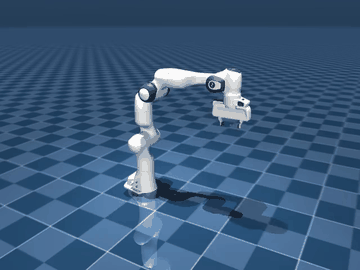
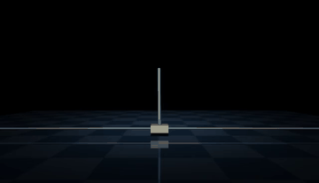

# robot-playground

Controller experiments on simulated robots in MuJoCo. Each experiment asks one question about a controller's limit, such as "how hard a push can it take?". It sweeps the disturbance to the failure point over 5 seeds, and checks the result against an outside proof: an analytic bound, a second implementation, or a linear model.

| Panda, damped least-squares reach | Cart-pole, LQR: recovers from a push |
|---|---|
|  |  |

## Quick start

Install [uv](https://docs.astral.sh/uv/). Then run one command. `uv run` makes the environment, installs the packages, and runs the tool:

```sh
git clone https://github.com/prem-chand/robot-playground.git && cd robot-playground
uv run robot-pg doctor
```

The Python package and the CLI use the short name `robot-pg`. `robot-pg doctor` prints the Python, MuJoCo and NumPy versions and the CPU. The last line is `ok`. The project uses Python 3.12.

To run the cart-pole experiment again (about 3 minutes on a 6-core laptop CPU):

```sh
uv run --extra dev --extra viz python experiments/cartpole_lqr/run.py
```

## Results

All values are the median of 5 seeds, unless the row says otherwise. Each experiment folder holds the script, `NOTES.md`, the result JSON, the plots and the videos.

| Experiment | Question | Result | Outside proof |
|---|---|---|---|
| [Panda: reach limits](experiments/panda_reach/NOTES.md) | At what torque limit and latency does a 1 cm reach fail? | Torque: 0.51 of nominal, or 0.96 if the arm must stay off its joint stops (4 of 5 seeds). Latency: 111 ms. | Static gravity bound (0.59), joint-limit constraint forces |
| [Cart-pole: LQR limits](experiments/cartpole_lqr/NOTES.md) | How large a push, and how much pole-mass error, can a fixed LQR take? | Push: 0.883 N·s (5 seeds within 0.06%). Stays up from 0.05 to 12 times the nominal pole mass. | `python-control` gives the same gain to 1.4e-14 |
| [Cart-pole: own PPO policy against LQR](experiments/cartpole_ppo/NOTES.md) | How large a push and tilt can a PPO policy trained in the author's own robot-playground-v0 repo take, against an LQR on the same plant? | Push: PPO 0.0024 N·s, LQR 0.190 N·s. Release tilt: PPO 0.014 rad, LQR 0.640 rad. The PPO falls with no push in 2 of 5 seeds, and holds 0.12 rad only on the side it trained on. | Replay of the robot-playground-v0 torch run to 5e-8, static capture bound 0.747 rad |

The prediction and the surprise for each result are in its `NOTES.md`. Several predictions were wrong, and the notes keep them.

## How an experiment works

1. Write the question and, where possible, a prediction in `NOTES.md` before any run. The notes say when a probe ran first and no blind prediction was recorded.
2. Find each limit by bisection, for each of 5 seeds. Each seed changes the start state and the sensor noise.
3. Check the limit against at least one outside proof. Examples are an analytic bound, a second solver, a delayed linear model from `mjd_transitionFD`, or the video.
4. Save `result.json`, the plots and the videos next to the script.

## Platform

Each controller is a block with a declared rate, latency, input signals, output signals and compute budget. Each run gets a content hash, so you can replay it bitwise. The hash covers the MuJoCo version, the full compiled model, the graph with each block's class, spec and `digest`, and the seed. Two runs with the same hash replay bitwise on the same machine, except the wall-clock timing rows.

The concept is in [ROADMAP.md](ROADMAP.md).

```sh
uv run --extra dev pytest -q
uv run --extra dev ruff check
uv run --extra dev pyright
```

## Layout

| Path | Contents |
|---|---|
| `src/robot_pg/` | Blocks, controllers, scenarios, the rollout loop, replay and the CLI |
| `src/robot_pg/robots/` | Robot models: cart-pole, the robot-playground-v0 cart-pole, diff-drive, Panda |
| `experiments/<name>/` | One script, `NOTES.md`, results, plots and videos for each experiment |
| `tests/` | Unit tests |

## Credits

- The Panda model comes from [MuJoCo Menagerie](https://github.com/google-deepmind/mujoco_menagerie).
- Each model folder keeps its license file and a `VENDORED.txt` with the source commit.

## Next

