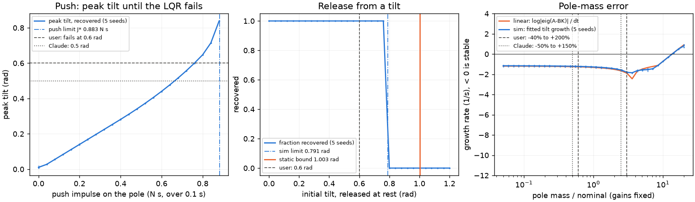

# Cart-pole LQR: push and mass-error limits

Run: `uv run --extra dev --extra viz python experiments/cartpole_lqr/run.py` (about 2 min on 6 workers). Numbers: `result.json`.

## Setup

- Model: `robots/cartpole/cartpole.xml`. Cart 1.0 kg, pole 0.3 kg, center of mass 0.4 m above the pivot. Cart force limit ±20 N. dt 2 ms.
- Controller: discrete LQR on the `mjd_transitionFD` linearization at `home`. Q = diag(1, 10, 0.1, 0.1), R = 0.01. The gains stay fixed at the nominal design.
- Failure: the pole passes 90°, or the cart passes ±3 m. "Recovered" also needs |tilt| < 0.05 rad at the end.
- Seeds (5): each seed draws a cart offset of ±0.05 m, a tilt offset of ±0.02 rad, the push sign, a push start from 1.0 to 1.2 s, and sensor noise (σ 1e-3 on qpos, 1e-2 on qvel).

## Question

1. How large a push on the pole can the LQR recover from? What is the peak tilt at that limit?
2. With the gains fixed, what range of pole-mass error keeps the loop stable?

## Prediction (recorded 2026-10-17, before any run)

- The author: the pole fails at about 0.6 rad of tilt. The mass error holds from -40% to +200%.
- Claude: failure at 0.5 rad, or when the cart force holds at its limit. The mass error holds from -50% to +150%.

## Result

| Quantity | Result (5 seeds) | Prediction |
|---|---|---|
| Push limit J* (0.1 s push at the pole's center of mass) | 0.8826 to 0.8831 N s | none |
| Peak tilt just below J* | 0.8465 to 0.8473 rad | author 0.6, Claude 0.5 |
| Release-from-rest tilt limit | 0.7898 to 0.7927 rad | author 0.6, Claude 0.5 |
| Pole-mass range that stays stable | 0.05× to 13.55× (-95% to +1255%) | author -40% to +200%, Claude -50% to +150% |

Both predictions were too low. The tilt limit is about 0.3 rad higher than predicted. The mass range is about 5 times wider than predicted.

## Outside proof

- **Analytic model.** The FD A and B match a hand-derived linearization to 1.7e-14. That derivation is a Lagrangian with semi-implicit Euler discretization.
- **Second implementation.** `python-control` `dlqr` gives the same K to 1.4e-14 and the same closed-loop poles to 1.4e-15.
- **Closed-loop eigenvalues.** The continuous poles are -7.17 ± 3.22j and -1.32 ± 1.01j (1/s). A 0.01 rad release in MuJoCo tracks the linear closed loop to 3e-5 of the release size. Near the nominal mass, the fitted tilt growth rate is -1.32/s. That equals the slow pole.
- **Mass boundary.** The linear spectral radius crosses 1 at 13.55× the pole mass. The simulated growth rate follows the linear curve across the sweep (right panel). Bisection on "stays up for 15 s" gives 13.68× to 14.21×. That is slightly above 13.55×, because near the boundary the growth is too slow to tip the pole in 15 s.
- **Static bound.** At rest with full force, the cart can stop the pole's fall only below 1.003 rad. The LQR release limit of 0.79 rad is below this bound, as it must be.
- **Video.** `push_recover.mp4` (0.95 J*) recovers. `push_fail.mp4` (1.10 J*) falls at 1.83 s. `heavy_pole.mp4` (1.2× the first unstable grid mass) shows the slow divergent oscillation.

## Surprise

1. **The mass margin is huge.** The loop stays stable from 5% up to about 13.5 times the nominal pole mass, with fixed gains. A full-state LQR with a high tilt gain (K_θ = -76 N/rad) has a lot of room. A heavier pole does not need a faster loop. It needs only enough tilt gain to beat gravity.
2. **A pushed pole survives more tilt than a released one** (0.85 rad against 0.79 rad). At the peak of a push, the cart already moves under the pole. A pole released at rest has no such start.
3. **The seeds barely move the limits.** The spread of J* is 0.06%. Offsets and noise of this size do not matter for a saturating LQR, and the system is symmetric, so the push sign does not matter either. The 5 seeds show that the limit is robust to these draws. They do not show a spread of practical size.
4. **The LQR uses only 79% of the static bound.** The LQR does not know about the force limit, so it saturates late.

## Next extension

- Sweep latency on the same cart-pole. That is the first experiment where the 5 seeds and noise should matter.
- Make the controller aware of the force limit: an MPC with the input bound, or an energy-based swing-up that hands over to the LQR. Measure how much of the 1.003 rad bound it recovers.
- Sweep a cart-mass error and a pole-length error. A length error changes the pole's natural frequency, so its margin may be much smaller than the mass margin.
