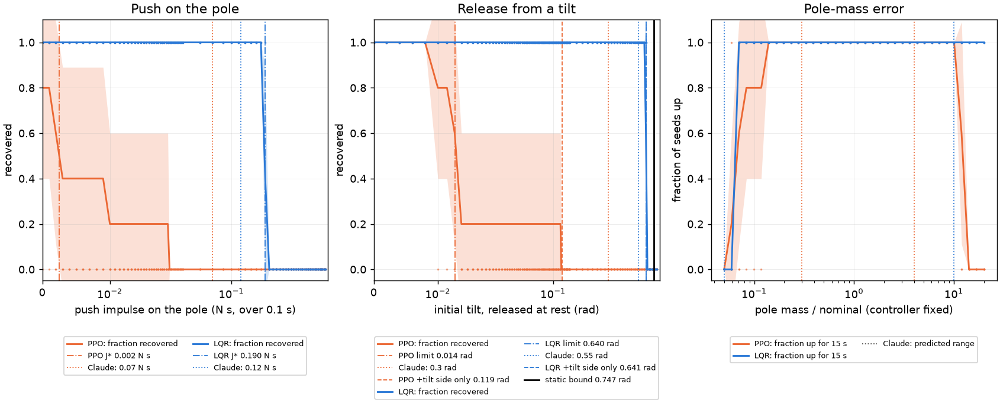

# Cart-pole PPO against LQR: push, tilt and mass limits

Run: `uv run --extra dev --extra viz python experiments/cartpole_ppo/run.py` (about 2 min on 6 workers). Numbers: `result.json`. `export_policy.py` rebuilds `policy.npz` in the robot-playground checkout. Its docstring gives the command.

## Setup

- Model: `robots/cartpole_playground/cartpole_playground.xml`, a byte-for-byte copy of robot-playground's `cart_pole.xml`. Cart 1.0 kg with slide damping 0.5. Pole 0.1 kg, a 0.6 m capsule with its center of mass 0.3 m above the pivot, hinge damping 0.01, armature 0.001. Cart force limit ±10 N. dt 2 ms. This is not robot-pg's own `cartpole` plant.
- PPO: the user's own policy. The user trained it with seed 0 for 200k steps in robot-playground, the user's own repo (not MuJoCo Playground). The checkpoint is `cart_pole_ppo.pt` at commit c67f5d8 (it entered the repo in 2650c98, sha256 `2dc28c24…f4b0`). The net is a 4-64-64-1 tanh MLP. The controller uses the mean action. `export_policy.py` writes the float32 weights to `policy.npz`, and `run.py` runs them in NumPy.
- PPO training setup (from robot-playground): reward 5 minus the LQR cost with Q = diag(1, 1, 10, 1) and R = 1. An episode ends at |tilt| > 0.2 rad, at |x| > 1.5 m, or at 10 s. Every episode starts from the same 5° tilt. The final action std is 0.29 N (log_std -1.242).
- LQR: a continuous CARE on the `lab.linearize` model of the same plant, with Q = diag(1, 1, 10, 1) and R = 1. These are the weights of robot-playground's LQR.
- Both controllers run at 50 Hz (control_dt 0.02 s) and hold the action between ticks, as in robot-playground.
- Failure, "recovered", seeds and noise are the same as in `cartpole_lqr`. Failure: the pole passes 90°, or the cart passes ±3 m. "Recovered" also needs |tilt| < 0.05 rad at the end. Each of 5 seeds draws a cart offset of ±0.05 m, a tilt offset of ±0.02 rad, the push sign, a push start from 1.0 to 1.2 s, and sensor noise (σ 1e-3 on qpos, 1e-2 on qvel).

## Question

1. How large a push on the pole, and how large a release tilt, can the user's PPO policy recover from? How does that compare with an LQR on the same plant?
2. With the policy fixed, what range of pole-mass error keeps the pole up for 15 s?
3. Does the policy stay up on robot-pg's own `cartpole` plant, which it never saw?

## Prediction (recorded 2026-11-16, before any sweep)

No user prediction was recorded. The prediction below is Claude's.

Before this prediction, Claude saw these facts and no sweep result:

- The checkpoint metadata and the PPO training setup above.
- The LQR gains. robot-playground's gain has a tilt gain of -36.98 N/rad. The `lab.linearize` gain has -38.54 N/rad.
- One LQR run from the 5° start on the vendored plant. It stayed up and its peak force was 3.2 N.
- robot-playground's own 10 s PPO run from the 5° start (the reference trajectory in `policy.npz`). It stayed up, its peak force was 2.5 N, and the cart ended at 0.21 m.
- The static capture bound by hand: atan(10 / (1.1 × 9.81)) = 0.747 rad.

Claude's prediction:

| Quantity | PPO | LQR |
|---|---|---|
| Release-from-rest tilt limit | 0.30 rad | 0.55 rad (about 0.75 of the static bound) |
| Push limit J* (0.1 s push on the pole) | 0.07 N s | 0.12 N s |
| Pole-mass range where all seeds stay up | 0.3× to 4× | 0.05× to 10× |

- The reason: the PPO policy never saw a tilt above 0.2 rad or a pole mass other than 0.1 kg. Outside that range the net extrapolates, and it has no reason to do well. The LQR knows the linear model and saturates only at the force limit.
- Transfer: the PPO policy stays up on robot-pg's `cartpole` plant from a 0.05 rad release for 5 of 5 seeds. Its raw output stays below 10 N there.
- Replay: robot-pg's NumPy port on MuJoCo 3.10.0 tracks robot-playground's torch run on MuJoCo 3.8.0 to better than 1e-6 in each state.

## Result

The draw gives seeds 0 to 3 a push and release toward -x (negative tilt), and seed 4 toward +x.

| Quantity | PPO (5 seeds) | LQR (5 seeds) | Prediction (Claude) |
|---|---|---|---|
| No disturbance, 15 s | Falls in 2 of 5 seeds (at 5.6 s and 12.2 s) | Stays up in 5 of 5 | none |
| Push limit J* (0.1 s push at the pole's center of mass) | Median 0.0024 N s, range 0 to 0.030 | Median 0.190 N s, range 0.189 to 0.192 | PPO 0.07, LQR 0.12 |
| Peak tilt just below J* | 0.020 to 0.042 rad (seed 3 has no J*) | 0.493 to 0.505 rad | none |
| Release tilt limit (tilt toward the seed's push sign) | Median 0.014 rad, range 0.0085 to 0.118 | Median 0.640 rad, range 0.640 to 0.642 | PPO 0.30, LQR 0.55 |
| Release tilt limit, +tilt for every seed | 0.118 to 0.122 rad | 0.640 to 0.643 rad | none |
| Release tilt limit, -tilt for every seed | 0.0085 to 0.015 rad | 0.640 to 0.643 rad | none |
| Pole-mass scales where every seed stays up for 15 s (start tilt +0.05 rad) | 0.14× to 10.1× | 0.070× to 20× (the grid end) | PPO 0.3× to 4×, LQR 0.05× to 10× |

- PPO seed 3 falls at zero push inside the 6 s run, so its J* is 0.
- Several PPO limits are limits of the 6 s window, not capture limits. PPO seed 0 passes the 6 s push and -tilt tests at small values, but it falls at 12.2 s with no push at all. With a 15 s window, seed 0 would fail at zero push, as seed 3 does in 6 s.
- The PPO predictions were much too high. The median push limit is about 30 times lower than predicted, and the median release limit is about 20 times lower.
- The LQR predictions were too low: 0.190 N s against 0.12, and 0.640 rad against 0.55.
- The PPO mass range is wider than predicted. But that test starts with a +0.05 rad tilt, which is the policy's good side (see Surprise 2).

**Transfer probe.** On robot-pg's own `cartpole` plant, from a 0.05 rad release, the PPO policy recovers in 1 of 5 seeds. Seed 4 (+tilt) recovers. Seeds 0 to 3 (-tilt) fall at 1.67 to 1.81 s. The same release on the vendored plant gives the same split: seed 4 recovers, and seeds 0 to 3 fall at 1.61 to 1.69 s. So the release direction causes the falls, not the plant change. The raw policy output on robot-pg's plant peaks at 1.13 to 1.54 N. It never exceeds 10 N, so the ±20 N limit of that plant never comes into use. With a +0.05 rad release for every seed, the policy recovers on robot-pg's plant in 5 of 5 seeds, with a peak raw output of 1.27 to 1.54 N. Claude predicted 5 of 5 seeds up. That was wrong for the -tilt seeds.

## Outside proof

- **Port against torch.** The NumPy forward pass matches torch to 9.5e-7 N over 10,000 random states in the fail box. That is float32 rounding. `run.py` and the export script give the same value.
- **Replay against robot-playground.** robot-pg's NumPy port on MuJoCo 3.10.0 replays robot-playground's torch run on MuJoCo 3.8.0 (10 s from 5°). The largest state difference is 4.7e-8 m in x, 2.1e-9 rad in tilt, 2.3e-8 m/s and 1.1e-8 rad/s. The largest force difference is 2.4e-7 N. That is at float32 rounding level, so the MuJoCo version change does not matter for this model. This agrees with the prediction of better than 1e-6.
- **LQR gain against robot-playground.** max |K - K_playground| is 1.53. The tilt gain is -38.51 N/rad here and -36.98 N/rad in robot-playground. With the joint damping set to zero, the difference falls to 1.5e-12. So the method matches, and the difference is the damping. robot-playground's `linearize.py` differentiates `qfrc_bias`. That vector holds no joint damping, because MuJoCo keeps damping in `qfrc_passive`. Its A matrix has zero velocity terms in the acceleration rows. robot-pg's gain uses the full model, damping included.
- **Continuous form of the discrete model.** robot-playground does not convert a discrete A. It differentiates the continuous dynamics. Here the acceleration rows come from the velocity rows of the one-step map, (A_d - I) / dt, and the position rows are the identity block. MuJoCo's Euler step treats joint damping as implicit, so `run.py` multiplies those rows by (I + dt M^-1 D). With this correction, the continuous B equals M^-1 times the force direction to 1.1e-16. Without it, B is off by 0.0055 (0.25%). With zero damping the correction does nothing, and K matches K_playground to 1.5e-12.
- **Closed loop at 50 Hz.** The continuous LQR poles are -6.34, -3.32, -3.20 and -0.314 (1/s). With a 50 Hz hold, the discrete spectral radius is 0.9937, which equals exp(-0.314 × 0.02). The hold does not reduce the stability of the LQR.
- **Static bound.** Bisection on the rigid-body equations gives 0.7474 rad. The closed form atan(10 / (1.1 × 9.81)) gives the same value. The LQR release limit of 0.640 rad is 0.857 of this bound, below it as it must be. The PPO median is 0.019 of it.
- **PPO rest points.** The PPO force at rest and upright is zero at x = -0.115 m and at x = +0.118 m. With the local slope of the net, the linear closed loop has an eigenvalue of +0.22 /s at x = -0.115 m (unstable). At x = +0.118 m every eigenvalue is negative, and the slowest is -0.148 /s. So the policy has one stable rest point, 0.118 m to the right of center.
- **One boundary per limit.** For each controller and seed, no grid point passes above the first failure. The bisection runs between the last pass and the first failure on the grid. The grids are fine where the PPO fails: 0.001 N s steps below 0.04 N s, and 0.002 rad steps below 0.14 rad.
- **Video.** `lqr_push_recover.mp4` (0.95 J*, 0.182 N s) recovers. `ppo_push_recover.mp4` (0.95 J*, 0.0012 N s) recovers. `ppo_push_fail.mp4` (1.10 J*, 0.0014 N s) does not fall in 6 s, but its tilt is still above 0.05 rad at the end. For seed 0, the PPO push limit is a timing limit on a slow drift, not a capture limit.

## Surprise

1. **The PPO policy falls with no disturbance.** Two of 5 seeds fall within 15 s, and both start with a negative tilt. In both, the cart drifts toward -x, past the unstable rest point at -0.115 m, to -0.39 m and -0.38 m before the pole falls. The 3 seeds that stay up never pass -0.074 m.
2. **The PPO policy works on one side only.** From a +tilt release it holds 0.118 to 0.122 rad. From a -tilt release it holds only 0.0085 to 0.015 rad, 8 to 14 times less for each seed. Every training episode started at +5°, and robot-playground's reference run ends with the cart at +0.21 m. The policy did not learn the mirror case. The LQR is symmetric to 0.004 rad.
3. **Past its training range, the policy pushes the wrong way.** The transfer probe and its control have 8 falls. In each, at the first tick past |tilt| = 0.2 rad, the tilt is -0.20 rad, the tilt rate is about -1.0 rad/s, and the PPO force is +0.51 to +0.56 N. A pole that falls toward -x needs a force toward -x.
4. **Even on its good side, the PPO holds less than a fifth of the LQR.** The +tilt release limit is 0.12 rad against 0.64 rad. That is a little above the 0.087 rad training start and below the 0.2 rad training cutoff.
5. **The seeds matter for the PPO, not for the LQR.** The draw has 4 negative push signs and 1 positive. So the PPO medians are the -tilt values. For the LQR, the 5 seeds move J* by 1.4%.

## Next extension

- Retrain in robot-playground with a random start tilt sign and a random cart offset. Then rerun this experiment. The test: does the -tilt limit rise to the +tilt limit?
- Make the policy odd by construction, u(s) = (π(s) - π(-s)) / 2, with no retraining. Measure how much of the LQR limit it recovers.
- Add an LQR row with K_playground (no damping) only if a later controller lands near the LQR limits. Here the gap to the PPO is too large for a 4% gain change to matter.
