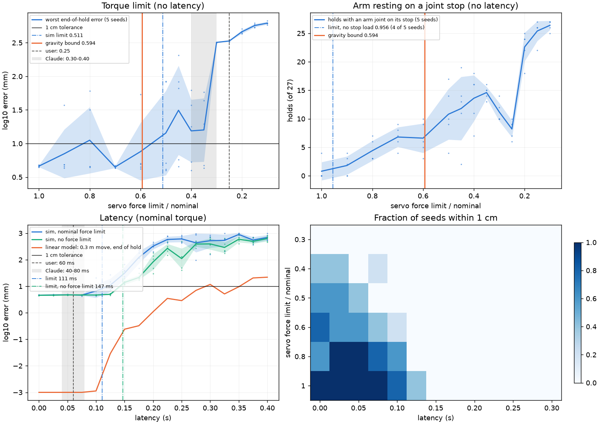

# Panda DLS reach: torque-limit and latency limits

## Question

The existing DLS `Reach` block sends joint position targets to the Panda position servos. It reaches a grid of end-effector targets.

1. As each servo's force limit drops to a fraction of nominal, where does tracking fail?
2. As the latency from sensing to the applied command grows, where does tracking fail?

## Prediction (recorded 2026-10-17, before any run)

- The user: tracking fails at 25% of the torque limit and at 60 ms of latency.
- Claude: tracking fails at 30–40% of the torque limit, when the shoulder can no longer hold the arm against gravity, and at 40–80 ms of latency.

## Method

- Controller: the `Reach` block (DLS, step gain 2.0, damping 0.1) sends joint targets to the menagerie position servos. It follows the `panda.reach_grid` scenario: 27 targets, 2 s each, 54 s in all.
- Torque limit: scale `actuator_forcerange` of the 7 arm servos.
- Tracking fails when the worst end-of-hold hand error is above 1 cm.
- Seeds 0–4. Seed 0 uses the nominal target order and `home`. The other seeds permute the targets and add ±0.02 rad to each arm joint. Observation noise: 1e-3 on the joints and on `ee_pos`.
- Limits: bisection per seed, 8 steps.
- Run: `uv run --extra viz python experiments/panda_reach/run.py` (about 45 min on 6 cores). It writes `result.json`, `limits.png`, and four videos (the first 12 s).

## Result

| Limit (5 seeds) | Sim, median (range) | The user | Claude |
|---|---|---|---|
| Torque, hand within 1 cm | 0.51 (0.34–0.62) | 0.25 | 0.30–0.40 |
| Torque, hand within 1 cm and no arm joint on its stop | 0.96 (0.88–1.00), 4 of 5 seeds | | |
| Torque, every seed fails | 0.30 | | |
| Latency, nominal force limit | 111 ms (92–133) | 60 ms | 40–80 ms |
| Latency, no force limit | 147 ms (147–148) | | |

- Torque: the hand-error rule is not monotone. Two seeds fail at 0.8, but only one fails at 0.6. The failures at 0.8 are holds where the arm is still moving slowly at the end of 2 s. Below 0.3, every seed fails by 30–60 cm, and the arm slumps to the floor ([torque_fail.mp4](torque_fail.mp4)).
- Latency: the arm tracks to about 110 ms, which is above both predictions. The limit moves out to 147 ms with no force limit.
- The two axes interact (map). At 0.6 of the force limit, only 1 seed of 5 still tracks at 100 ms.

## Outside proof

1. Static gravity. At the nominal hold poses, the shoulder (joint 2) needs 59% of its 87 N·m limit to hold the arm (median of 5 seeds, 0.52–0.61). Below 0.59, the servos cannot hold those poses. The hand-error limit of 0.51 sits under this bound, which looks wrong at first. The joint-stop count explains it (the first item under Surprise).
2. Joint-stop load. At each end of hold, I read MuJoCo's joint-limit constraint forces. A hold is "on the stop" when an arm stop carries more than 1 N·m. In a probe at 1.0, 0.85, 0.7, and 0.4, every such hold had joint 2 on its 1.76 rad stop.
3. Delayed linear model. The DLS loop linearized at `home` with `mjd_transitionFD` decays at every latency up to 0.4 s, and its peak error never grows past the start error. So the linear loop has no delay instability. With no force limit, the sim still fails at 147 ms. The linear model at `home` says a 0.3 m move ends a 2 s hold with 1 cm of error only near 0.3 s.
4. Video. [nominal.mp4](nominal.mp4) reaches each target. [torque_on_stop.mp4](torque_on_stop.mp4) at 0.7 reaches, but the shoulder leans on its stop. [torque_fail.mp4](torque_fail.mp4) at 0.41 slumps.

## Surprise

- The hand-error rule hides a cheat. Below the gravity bound, the shoulder servo cannot hold the arm, so the arm falls onto the joint-2 stop. The redundant arm then reshapes its other joints, and the hand still lands within 1 cm. At 0.35, seed 0 reaches hold 9 with joint 1 at 1.08 rad and joint 4 at -2.26 rad. At nominal force, those joints are at 0.01 and -0.52. The posture differs by up to 2 rad, and the shoulder need at that hold drops from 0.59 to 0.28. A real Panda faults when it hits a joint limit. So the honest torque limit is about 0.96, not 0.51.
- Seed 0 rests on the shoulder stop even at nominal force, on 4 holds. The DLS ignores joint limits, and the nominal target order drives the arm onto the stop. The other 4 seeds start to touch the stop between 0.88 and 1.0.
- Latency was not the delay instability I expected. The linear loop is stable at every latency. With the force limit, saturation brings the failure in from 147 ms to 111 ms. The 147 ms failure with no force limit is still not explained. Candidates are the joint stops and the servo ctrlrange clip, which the linear model at `home` does not have.

## Next extension

- Add joint limits to the reach. Use a null-space term that pushes away from the stops, or clamp in a QP. Then sweep the torque again with the stop rule.
- Find the 147 ms failure. Run with no force limit, no stops, and no ctrlrange clip, one at a time.
- Put operational-space control (torque mode) next to DLS on position servos, with the same sweeps.
- Use longer holds, or a settle test, so that slow arrival does not count as failure.
